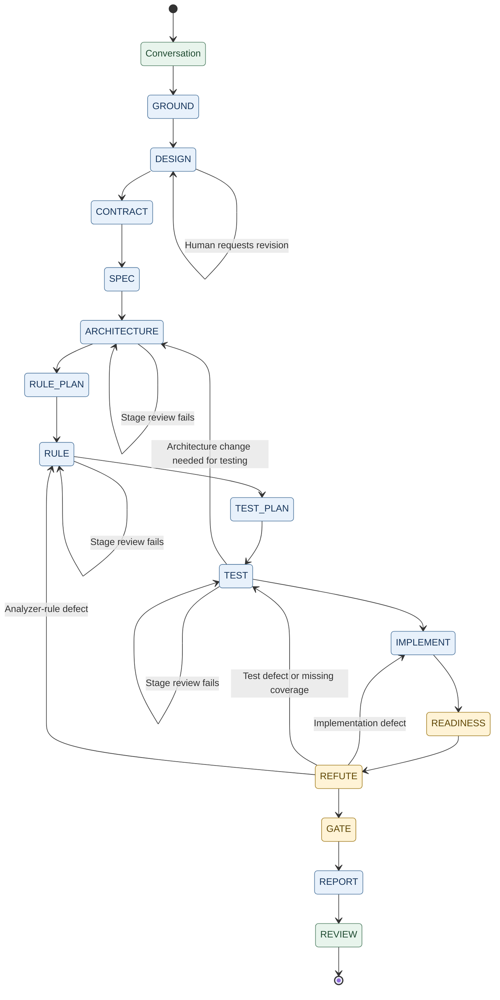

# Guard process workflow

Issue: https://github.com/4thWAIV/agent-guard/issues/82

## Starting point

Tim requested this work item to develop the vision in [issue.md](issue.md). We are defining the document structures before mapping the complete phase flow and designing the state machine. This is design discussion, not a signed approval record or implementation contract.

The C# files linked below hold the draft type definitions. This conversation records the discussion and refers to those files; it does not duplicate their definitions. The eventual tool-managed, signed workflow is the destination, not functionality already delivered.

## Intended document flow

The conversation represents the user's input and continues through relevant workflow phases. Guard and other phases append evidence through tools or produce separate tool-managed artifacts linked from the conversation. At the appropriate point, the tool extracts the relevant conversation sections into the contract upon request.

The intended structured representation is YAML. Workflow and Conversation serialize into separate files and cross-reference each other by stored-file paths, not C# object references. The serialization implementation and final file naming remain to be defined.

Scope, investigation areas, and capabilities to search for belong in the document representing the user's input. The coordinating agent should not rewrite them into a second set of instructions.

AgentGuard is intended to participate in stage transitions as well as document modification. Protected sections are changed through the system. The modification rules can depend on the stage already entered and require presence checks and user approval. Every alteration is recorded, and subsequent alteration is detectable.

The tool interface should accommodate patch-style edits and Claude-style edits, with both documented in its help. Eventually, server signatures associate protected content with workflow and agent-session GUIDs across providers.

## Current definition files

- [IWorkflow.cs](IWorkflow.cs) — the outer workflow structure.
- [WorkflowLevel.cs](WorkflowLevel.cs) — the level records, stage selections, reviewer selections, and execution requirements.
- [IConversation.cs](IConversation.cs) — the conversation structure and its list-entry types and statuses.
- [CertifiedResults.cs](CertifiedResults.cs) — the envelope for results requiring certification.
- [IPlan.cs](IPlan.cs) — the planning structure, planned cases, expectations, and certified human input.
- [PriorArt.cs](PriorArt.cs) — the prior-art assignment types stored inside Workflow, agent results, ledger references, and search-and-capture interface.
- [PlatformResearch.cs](PlatformResearch.cs) — the external documentation, SDK/library and reference-library request types, source reads, and shared captures.
- [AgentRun.cs](AgentRun.cs) — the agent-run tracking draft with execution-owned start and end timestamps.
- [StageExecution.cs](StageExecution.cs) — the stage, attempt, and nested assignment tracking drafts, plus assignment and versioned-file references.

Read the definitions from these files. They are design files in this work folder, not integrated production code. Which results require certification has not yet been selected.

## Guard-managed document edits

Structured documents serialize as YAML and conform to the C# definitions. Document changes go through the Guard CLI or a Guard MCP server. Both support Codex-style patches and Claude-style substitutions through the same editing rules, not separate permission mechanisms.

Every edit explicitly identifies the document section being changed. Neither editing style grants arbitrary whole-file editing. Guard checks the operation against the document structure, workflow state, and required approval, and records the alteration.

Signing and validation must prevent an out-of-tool alteration from being accepted as an authentic document. The eventual server signing protocol remains to be designed.

## Design tracking

[Artifact usage map](workflow-artifact-usage.html) now separates the existing scripts from the replacement design. Each stage and substage identifies the reader or writer, the selected information, its purpose, its source function/type, and whether it moves as a file, returned object or tool response. Current script prompts were traced through dispatch and returned results; proposed replacement bindings are not presented as implemented readers. The process inventory in [workflow-artifact-usage.js](workflow-artifact-usage.js) supplies the matrix, overview I/O and drill-down diagrams. Counts derive from those relationships; they are not physical-file totals or runtime access measurements. Unspecified relationships are marked unresolved, not unused. No artifact removal, runtime change or new type is approved by this audit. The [matrix image](workflow-artifact-usage.svg) is generated from the same inventory.

The audit exposes missing definitions rather than filling them with inferred reads. `DesignAssignment` references GROUND results but has no pinned task-requirements reference. Most later stages do not yet have replacement assignment/result types. Current DESIGN and review scripts transfer agent objects within prompts; that is not proof that separate files were saved. Current READINESS has no implementation-result parameter, and REFUTE explicitly receives only the GROUND, DESIGN and hidden-decision aggregate paths. REVIEW remains a terminal name with no specified work. These findings do not change the approved stage order or approval process.

The workflow diagram's stage-symbol ledger is owned by `stageSymbols` in [workflow-phase-details.js](workflow-phase-details.js). The overview and internal maps render that same ledger. File badges identify their producer and retain that symbol when reused downstream; action labels identify the executing stage. EX marks external/existing inputs. These are presentation symbols, not new workflow states.

[File modification legend](file-modification-taxonomy.html) separates file categories, file operations and future validation of changes inside files. It includes workflow outputs and tool-captured evidence. This is a taxonomy for review, not an installed permission policy; project patterns and operation grants remain to be defined. The page displays the [legend image](file-modification-taxonomy.svg) without copying its content.

The workflow overview and internal maps now show edit-scope panels using the legend's file-category and named-change icons. Stage mappings and shared icon definitions are owned by [workflow-phase-details.js](workflow-phase-details.js); SVG/PNG images are presentation exports. Edit scope remains separate from verification requirements. These panels do not install enforcement or grant delete/move authority. REVIEW's undefined edit scope remains visible.

The diagram labels the initial request as GitHub Issue and the existing project source as Source Code. Each input/output artifact has its own directional document symbol. Overview and detail views share the artifact names and expected build/test/warning states in [workflow-phase-details.js](workflow-phase-details.js); exported images are generated from that presentation source. The expected states are not execution evidence. Certified human guidance on individual planned cases remains separate from the GitHub Issue. No workflow script, runtime schema or warning authorization is changed by this visual update.

The full workflow page supports zooming into every stage. Each drill-down is generated from the same reader/writer inventory as the usage page, not a second list of assumed inputs. The overview lists only incoming dependencies above a stage. Results created and consumed inside that stage appear as internal handoffs, with the producing and consuming steps identified. They still count as reads in the usage matrix. Existing documents such as Workflow can be both incoming and updated outputs; correction-only findings refer to a previous attempt. Coding, tool execution, and returning the result are separate steps of the same coding agent, not additional agents. The overview retains verification states, edit categories and proposed exit checks from [workflow-phase-details.js](workflow-phase-details.js). These maps remain design-review material, not approved runtime definitions.

[Full workflow with stage work and exit checks](workflow-exit-flow.html) shows the complete sequence, the activities inside each stage, input/output references, and unfinished work mapped to what it blocks. The [scalable image](workflow-exit-flow.svg) owns the drawing; the web page displays it. Exit wording not already settled is a proposal for review. Purple notes identify missing definitions rather than granting execution-time discretion. This is a visual design review, not a new runtime schema or approval policy.

Tim approved keeping one design checklist in this conversation. The C# files own the type definitions; checklist entries link to them rather than copying them. No separate status reports are needed.

Each stage is tracked using these six entries. Each entry distinguishes decided details from still-open details. An unresolved detail is not permission for an agent to choose.

| Entry | What must be settled |
|---|---|
| Inputs | Exact document types, sections, and versions the agent receives. |
| Outputs | Structured results the agent must produce, with links to their C# definitions. |
| Allowed edits | Which document sections that agent may create or change. |
| Judgment | What is checked mechanically, what an independent agent evaluates, and what constitutes a defect. |
| Transitions | Conditions for advancing, correcting, or returning to another stage. |
| Human approval | Which specific edits or transitions require presence and approval. |

### Transition approval default

Human approval is required for every transition by default, including forward transitions, self-loops, and returns to earlier stages. An exception must identify the specific transition and explain why it does not need human approval. It takes effect only after the human explicitly approves it. No exceptions have been approved in this design.

The diagram shows paths, not permission to execute them automatically. A successful result or a failed review does not itself remove the human-approval requirement.

### GROUND checklist

The checklist below is not implemented behavior. Recorded decisions elsewhere in this document settle the corresponding items; remaining proposals stay open. Existing script interfaces are inventoried in [workflow-inputs-outputs.md](workflow-inputs-outputs.md). Prior-art drafts are in [PriorArt.cs](PriorArt.cs); exploration output types and Guard command syntax remain to be defined.

[GROUND process and file-flow diagram](ground-data-flow.svg) places each GROUND process between its input files and saved output files. The saved prior-art search result visibly feeds the reuse judge; original outputs feed downstream stages. Dashed boxes mark structures or input bindings not yet defined. Platform/API research's position in the sequence remains undecided. File labels are roles, not additional filename decisions; the diagram does not change transition permissions or introduce a new result report.

**Inputs**

- Guard supplies the selected Workflow and Conversation versions. Field definitions remain in [IWorkflow.cs](IWorkflow.cs) and [IConversation.cs](IConversation.cs).
- Investigation assignments come from Conversation's investigation areas; reuse-search assignments come from its capabilities. The coordinating agent does not rewrite either assignment.
- Agents inspect the working-tree code and identify the code version/state their evidence describes. The exact source-state identification mechanism remains open.
- Conversation supplies the work instructions, as recorded under [Prior-art input ownership](#prior-art-input-ownership--no-separate-input-or-assignment-file). The existing scripts' live-issue precedence is inventoried separately; it does not define the new input ownership.

**Outputs**

- Each exploration agent produces its assigned area, code facts with evidence, affected files/stores, open questions, and any decisions resolved by an existing approved principle with the supporting evidence.
- Each prior-art search agent produces its assigned capability, candidates with source locations and snippets, searches performed, completed-empty searches, and search errors.
- Each reuse judge produces the determination defined in [PriorArt.cs](PriorArt.cs), including the approved Unresolved case when research cannot yet support a resolved determination.
- Proposed retention: keep the exact structured results from all three agent types and their evidence, linked as GROUND's outputs. Do not replace them with an orchestrator-written summary. Unlike the current completed ledger, this retains the search results as well as the rulings.

**Allowed edits**

- Exploration agents, search agents, and reuse judges write only their assigned result sections through Guard. They do not edit source code, workflow instructions, human decisions, or another agent's result.
- Guard records progress and links accepted result artifacts to the workflow. Exact section selectors, create/update operations, and result-correction permissions remain open.

**Judgment**

- Mechanical validation checks the output structure, assignment identity, required result coverage, and artifact identity/version. A valid structure or signature does not prove a code claim true.
- The reuse judge receives the exact search result for its assigned capability, not rewritten search prose. Existing CodeGraph and grep discovery requirements remain the basis for the proposed search contract.
- A failed search is not an empty search. A new-capability ruling requires both required searches to complete without a candidate; reuse/extend/extract requires identified source evidence.
- Defects in the existing project are findings for downstream work, not a reason for GROUND to repair the project or repeat its investigation. Correction and resumption follow [Attempts and resumption](#attempts-and-resumption); this does not waive transition approval.
- Any additional independent review of exploration facts remains undecided; no new reviewer is assumed.

**Transitions**

- The existing internal sequence is exploration, prior-art search, then reuse judgment. The proposal preserves that sequence and the independent reuse judge.
- GROUND is ready for handoff when the assigned investigations and required searches/rulings have valid retained outputs. Open questions remain explicit outputs rather than being silently answered by an agent.
- GROUND → DESIGN requires human approval. Internal transitions and repeats also retain the default human-approval requirement; no exception is proposed here.
- Handling an empty capability list remains open. Resuming interrupted or defective assignments follows [Attempts and resumption](#attempts-and-resumption). Completed work must not be represented as missing merely because another assignment did not finish.

**Human approval**

- The approved default remains: every transition requires human approval until a specific exception is approved.
- No agent changes investigation scope, capability assignments, or human decisions as an incidental part of producing a result. Exact Guard protection and approval operations remain to be defined.

Continue the same six-entry checklist for each subsequent stage in diagram order as its definition is discussed.

## Approved prior-art category addition

Tim approved adding `extend` to the prior-art determination categories: `reuse`, `extend`, `extract`, and `new`. `extend` means existing code owns the responsibility but needs additional behavior to satisfy the requirement. This is a design decision for the new prior-art structure; the current workflow scripts remain unchanged.

Tim subsequently approved `Unresolved` as a fifth determination category. The evaluation contains one non-null decision. An unresolved decision owns its questions; there is no separate unresolved-question list to synchronize with a nullable decision. Guard requires at least one nonempty question for this category. The resolved decision types retain their candidate references, reason, and required changes. The definitions are in [PriorArt.cs](PriorArt.cs). Search and evaluation evidence remain retained when a determination is unresolved.

## Prior-art search and capture

Tim approved recording the search-and-capture structure and explanation below. The C# definitions are in [PriorArt.cs](PriorArt.cs); they are not copied here. This defines the proposed interface, not an implemented tool. Prior art covers our own codebase, not external API or library research.

### Agent requests

`PriorArtSearchRequest` is the common base for either search request and cannot be instantiated alone. Its `AssignmentReference` locates the work registered inside Workflow. The tool follows that assignment to the selected Conversation entry and version, rather than accepting an agent-written replacement of the project, scope, or capability description.

`StructuralSearchRequest` is used to investigate symbols and relationships such as classes, methods, and callers. The search agent supplies a query, and the tool executes it through CodeGraph. CodeGraph's source-file limit of 20 is a known backend constraint, not a recurring warning or blocker.

`TextSearchRequest` is used to find occurrences in source text, including shared primitives whose callers may have different names. The tool executes it through ripgrep. `TextMatchKind` makes the agent distinguish literal matching from regular-expression matching; the same pattern can mean different things under those two interpretations.

Neither request accepts arbitrary command-line arguments. Backend selection and argument construction belong to the tool, so a backend can be replaced without changing the agent-facing request types.

### Execution and receipt

`IPriorArtSearch` is the C# interface behind the CLI or MCP operation. It resolves the registered work through Workflow, reads the referenced instructions from Conversation, selects the backend, constructs and executes the command, captures its output and outcome, saves the capture, and returns its location. The agent does not write the captured output. Cancellation is requested through the operation's cancellation token.

`SearchReceipt` returns the saved capture's location after it has been written. The search agent reads that capture and references it in its structured search result rather than copying the output into another evidence file.

### Captured evidence

Tim approved keeping each piece of data in one place and referencing it elsewhere rather than maintaining duplicate values. `SearchExecution` therefore keeps only its identity and capture reference. The agent result no longer repeats the tool, query, scope, or status; execution details are read from the tool-written capture and its referenced assignment.

`PriorArtSearchCapture` references the saved request by file path and owns the executed command and execution result. The tool saves the request once and links it from the capture, rather than embedding a second copy. The tool creates execution evidence from the process execution, not from an agent's later account.

`ExecutedCommand` records the actual executable, individual arguments, and working directory. Backend names appear here as evidence of what ran, not as part of the agent-facing request types. Arguments are passed as an array rather than as a shell-command string.

`SearchExecutionResult` preserves normal output, error output, the execution outcome, and any available exit code. An execution error records failures such as being unable to start the program. A process that could not start has no exit code.

`SearchStatus` distinguishes a completed search, including one with no matches, from failed execution. Each backend interprets its exit codes accordingly. The existing enum is reused rather than introducing a second status definition. Any output produced before a failure is retained.

### Handoff

Tim approved references wherever another document needs data owned elsewhere. The earlier handoff through standalone search and evaluation input files is superseded by [Prior-art input ownership](#prior-art-input-ownership--no-separate-input-or-assignment-file). Workflow identifies the inputs used and the saved results; agents do not copy the instructions or findings into Workflow. The reuse judge receives the versioned search-result reference in its nested assignment. Each ledger entry links the search and evaluation results. Candidate IDs reference candidates within the search result rather than copying their content.

The search agent creates a structural or text request. The search tool executes it, saves the capture, and returns the receipt. The search agent reads the capture and produces candidate findings that reference it. The reuse judge reads those candidates and the original evidence to determine whether and how existing code can satisfy the requirement.

These types define search and capture; they do not replace the candidate findings, reuse determination, or ledger structures already drafted. Assignment inputs now use path-and-Git-blob references. Version binding for the remaining artifact references, YAML serialization, certification, and Guard command syntax remain undefined. The nullable determination proposal was replaced by the approved unresolved decision type described above.

## Discussion so far

We started with the existing relocation conversation rather than introducing a replacement organization: [SystemServices relocation conversation](../../completed/run-records/74-pre-work-move-system-services/conversation.md).

The existing command inputs and outputs are inventoried in [workflow-inputs-outputs.md](workflow-inputs-outputs.md). It is a reference for the current scripts, not the authority for the evolving C# definitions. The linked C# files hold those definitions.

Stages and reviewers are distinct. The level records express the fixed selections and the choices the caller may supply. Optional selections and permanently absent work have different meanings; their definitions are in WorkflowLevel.cs.

Stage reviewers must be a subset of the workflow's enabled reviewers. If SOLID is not enabled for the workflow, no stage runs a SOLID reviewer. The Test Reviewer is the exception and is always required when the Test Stage runs. TDD is renamed TEST in this design. This records the intended design; the workflow scripts have not been changed to implement it.

Conversation now represents the instruction content needed by GROUND. The remaining ordinary GROUND inputs are represented by Workflow. No additional Conversation property was identified as necessary for GROUND's current inputs. This comparison did not add other phases' inputs or GROUND's outputs to Conversation.

The existing caller-supplied resume arguments will be replaced by the workflow's reusable state management, not preserved as a separate caller-managed execution interface. The tracking drafts and approved resumption behavior are recorded under [Approved execution hierarchy](#approved-execution-hierarchy).

## Workflow state diagram

[Full workflow process and artifact flow](workflow-process-flow.html) shows inputs above each process and saved outputs below, using matching artifact names and links back to their producers. It covers Conversation through REVIEW, with expandable proposed resolution subflows. The recorded stage order is preserved; downstream I/O roles and closure routes without approved C# definitions are explicitly proposed. It does not replace original structured results, approve new transitions or create new runtime schemas. The GROUND-only diagrams remain detailed views of that stage.

This shows all currently defined stages in order, with Conversation as the initial state and REVIEW as the terminal state. REFUTE returns to IMPLEMENT when a defect requires an implementation fix; the existing path then runs through READINESS back to REFUTE. Other loops and level-dependent paths remain to be defined. Existing stage selections are defined in [WorkflowLevel.cs](WorkflowLevel.cs); the level-specific selections for SPEC, RULE_PLAN, and TEST_PLAN have not yet been defined.

Blue marks work stages, amber marks checking stages, and green marks Conversation and REVIEW. For the self-loops, RULE and ARCHITECTURE use the enabled SOLID, DRY, and Lie-catcher reviewers. TEST uses the Test Reviewer and the enabled DRY and Lie-catcher reviewers.

## Rule and test planning

Rule planning and test planning are separate responsibilities from implementing the rules and tests. The planning agent sets expectations before execution rather than leaving the implementation agent to both make the plan and implement it.

Each planned case carries one of these expectations, with a reason:

- Expected pass — reason.
- Expected fail — reason.
- Unknown — reason.

Result evaluation focuses on outcomes that do not match their planned expectations and on Unknown cases. An independent evaluator determines why a result differs rather than leaving that judgment to the implementation agent.

Unknown cases are called out to the human during planning. The human may supply thoughts, which must accompany the case to the evaluator. After execution, the evaluator determines whether the test result is correct given the pre-implementation state of the code. Unknown does not mean that either outcome is automatically accepted.

SPEC follows CONTRACT and creates only the BDD Spec Plan. It writes a plan, not executable tests.

ARCHITECTURE follows SPEC. RULE_PLAN follows ARCHITECTURE and precedes RULE, using the architecture to plan what the rules must enforce. TEST_PLAN follows RULE and precedes TEST, providing the detailed test plan using the architecture.

TEST fans out to write both the spec tests and any unit tests. Planning and test implementation remain separate responsibilities.

Agent outputs need a defined structure by agent type, keeping work focused on the actual behavior, evidence, and correction needed rather than repeated debate over narrative documents. The starting planning structure is in [IPlan.cs](IPlan.cs). Execution and evaluation output types remain to be defined.

## Approved execution hierarchy

Tim approved four distinct levels: workflow → stage → attempt → agent run.

The workflow is the end-to-end effort. Each stage belongs to that workflow. Each attempt belongs to a stage. Each agent run belongs to an attempt. Stage and attempt are separate levels, not one combined stage-run level.

### Attempts and resumption

Tim approved the following distinction and reuse behavior:

- An interrupted agent or an agent that failed to return a usable result is rerun against the same assigned work as a new agent run within the same attempt. Missing agents can be started and the attempt resumed without restarting successful work.
- Completed work that was reviewed and requires correction starts a new stage attempt. The correction agents and their reviewers belong to that new attempt.
- Successful results are reused by reference rather than copied or regenerated. One agent halting does not invalidate successful work from other agents or force the entire attempt to restart. A new attempt can also reference unchanged successful results from an earlier attempt.

Tim approved the initial tracking definitions and subsequently directed the expansion of Workflow to store assignments inside stage attempts. The updated drafts are in [StageExecution.cs](StageExecution.cs) and [IWorkflow.cs](IWorkflow.cs), connected to [AgentRun.cs](AgentRun.cs). Stage names and assignment, attempt, and run dictionary keys identify their entries without repeated identity fields. The remaining disk layout is not yet defined.

### Registered work is the execution source

Tim approved saving the same agent assignments the workflow actually executes, without a separate checklist.

- Register the required work before dispatch. The workflow uses that registered work to launch agents, so tracking and execution use one assignment list.
- Record each agent run and its result against that work. Work whose agent never starts, stops, or returns no usable result remains visible.
- Resume only unfinished work and reuse applicable successful results. For dependent agents, attach upstream result references when those results become available.
- Conversation owns the instructions; Workflow registers which agents perform that work and the inputs/results they use. Guard stores that execution state. Neither the coordinating agent nor a second document reconstructs what should have happened. No separate narrative completion report is needed for this tracking.

The proposed separate attempt-input checklist is withdrawn. The filename `input.yaml` was not approved as the owner of required-work tracking. This decision does not define storage filenames, new tracking fields, or automatic-transition permissions.

### Agent-run timing

Tim approved starting timing with agent runs. The execution mechanism records a start timestamp and a nullable end timestamp, both represented by `DateTimeOffset`; the agent does not enter them. These support comparing when agent results were produced, observing running executions, and calculating durations and averages. The timestamps own this data; elapsed durations and averages can be calculated rather than stored as additional values to synchronize.

The agent-run draft is in [AgentRun.cs](AgentRun.cs). Timing for workflow, stage, and attempt remains undecided; this approval does not add timing to those levels or introduce a status-transition history.

## Prior-art input ownership — no separate input or assignment file

The prior-art substage has no separate input or assignment file. Conversation says what work to do. Workflow records the agents doing that work and the inputs/results they use.

| Conversation owns the instructions | Workflow owns execution tracking and input/output references |
|---|---|
| The capability description: what functionality to look for in our code. | The selected capability ID identifying that entry in Conversation. |
| Scope: where the investigation applies. | The Conversation file path and Git blob ID identifying the exact input version used. |
| Exclusions: what is outside the investigation. | Which agent runs, its status, start/end times, and the reference to its saved result. |

These columns identify ownership, not a row-by-row mapping. The Conversation reference selects the version of all the instructions, including scope and exclusions. Input/output references locate that input and the agent's saved output; they are not another set of instructions.

Search results, evaluation results, and evidence captures still have their own files. Workflow references those artifacts; it does not repeat their findings. Instructions are not copied out of Conversation into Workflow.

The C# drafts now express this ownership. [StageExecution.cs](StageExecution.cs) stores typed assignments inside each attempt; [AgentRun.cs](AgentRun.cs) identifies its assignment by that attempt's dictionary key. Prior-art-specific input references belong to the derived assignment records in [PriorArt.cs](PriorArt.cs), keeping the general tracking structure independent of prior art. Search requests and agent results reference the registered assignment instead of a standalone input file. Conversation's structure is unchanged.

`AssignmentReference` locates an assignment inside the changing Workflow document. `VersionedFileReference` identifies exact input bytes by path and Git blob ID. These are records within existing files, not new YAML documents. No serialization, Guard implementation, new transition permission, or extra history field is introduced by this draft update.

## Where the discussion paused

### GROUND to DESIGN handoff

Tim approved: "Use one `DesignAssignment` inside Workflow, with direct references to the existing result files. No wrapper, no new handoff file, no summary report."

The definition is in [StageExecution.cs](StageExecution.cs). It references exploration results, the prior-art ledger, and Platform/API research results using the existing `VersionedFileReference`. DESIGN follows the ledger to the search and evaluation results instead of maintaining another list of those files. `PriorArtLedgerEntry` in [PriorArt.cs](PriorArt.cs) now uses versioned references for both results instead of plain paths. No findings or instructions are copied into the assignment or ledger.

The proposed `GroundResultReferences` wrapper was not adopted. The result-file contents for exploration and Platform/API research remain to be defined; the handoff references do not define those contents.

### Platform/API research channels

The search model is drafted in [PlatformResearch.cs](PlatformResearch.cs). It covers documentation search, local SDK/library search, and source reading. It reuses the existing assignment and versioned-file references and text-match kind. Agent findings and platform-suitability evaluations remain to be defined separately.

Tim approved adding RefLib as the third channel with this recommendation: "add it as an additional documentation source, preserving corpus and section identity with the captured response."

Reference-library research lists available corpora, searches a selected corpus, and reads a selected section. These operations reuse the research capture, outcome and receipt types. A reference-library source retains the corpus and section IDs; Guard retains the actual returned content rather than treating a section ID as an immutable version. RefLib and an official website can reproduce the same documentation and do not automatically constitute independent evidence.

The [RefLib MCP documentation](https://www.reflib.online/mcp) describes `list_corpora`, `search`, and `read` over authenticated MCP. The public website search and section read were exercised; the authenticated MCP argument schemas have not been inspected. The draft defines Guard's interface, not RefLib's wire schema. No MCP configuration or connection was added.

As inspected on 2026-10-01, the [catalog](https://www.reflib.online/) includes C#, .NET, Linux APIs and Windows APIs, but does not list a macOS/Apple SDK corpus. The other research channels remain necessary. Corpus update dates on the [news page](https://www.reflib.online/news) are not proof of the platform/version to which a particular API claim applies.

### Platform selection and cross-platform findings

Tim approved workflow-wide platform selection: "workflow-wide platforms, stored once in Conversation." Per-capability platform overrides are not part of the selected design.

The approved flow is:

1. "Conversation states the capability once and selects the platforms once."
2. "GROUND returns findings for that capability on each selected platform, using the same result structure. Differences and unsupported behavior remain explicit."
3. "DESIGN uses those findings to define the shared interface and platform-specific implementations."

The selection defines research scope, not an API or implementation choice. Tim approved `TargetPlatform` and `IConversation.TargetPlatforms` in [IConversation.cs](IConversation.cs), and `PlatformResearchAssignment` in [PlatformResearch.cs](PlatformResearch.cs), as presented. Each platform has an ID and a description of the target environment, including required OS/runtime versions when applicable. The assignment selects one capability from the referenced Conversation version and reads all target platforms, scope and exclusions there. It stays inside Workflow; no additional input file is created. The research-result structure remains to be defined.

### Remaining definition work

[GROUND resolution-flow proposal](ground-resolution-flow.svg) visualizes tracked items from assigned work through research, human decisions, follow-up work and evidence-backed closure. It is a proposal for review, not an approved transition policy or new tracker. The loose unresolved-question list was not approved. Existing `Issue` and `ProposedDecision` types do not yet link questions to original results, follow-up assignments or resolution evidence; those relationships remain to be designed. The diagram preserves the existing human-approval default.

The tracking structure and human-approval default are approved. Next, define GROUND's required outputs and the Guard operations needed to produce them, then work through the remaining stage checklist entries.

The planning order is settled in the diagram: SPEC creates the BDD Spec Plan, RULE_PLAN creates the Rule Plan after ARCHITECTURE, TEST_PLAN provides detailed test planning, and TEST writes the spec tests and unit tests. The level-specific selections for SPEC, RULE_PLAN, and TEST_PLAN and the remaining agent output types are not yet defined.

Workflow state-management properties also remain open. The assistant proposed identifying the current stage and its status; those properties and their allowed values have not been accepted or added.

## Later questions still open

- Which results are certified, and which content requires approval to change at each stage?
- Which phase outputs are appended and which are separately stored and linked?
- When does the tool extract the contract, and how does it retain the connection to the conversation?
- How are serialization, revision tracking, signing, and stage transitions implemented?

These remain design questions, not selected mechanisms or authorization to implement them.
